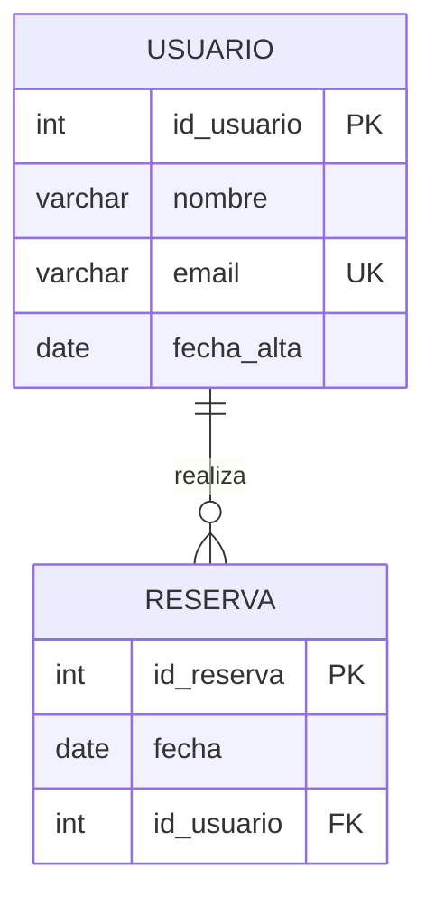

# Modelo relacional

<!-- LAB 03: una línea por tabla. Marcad la clave primaria con PK y cada clave
     foránea con FK → TABLA.columna. El ejemplo es genérico: sustituidlo. -->

```text
USUARIO (id_usuario PK, nombre, email UNIQUE, fecha_alta)
RESERVA (id_reserva PK, fecha, id_usuario FK → USUARIO.id_usuario)
```

## Relaciones

| Relación | Cardinalidad | Lectura en los dos sentidos | Al borrar |
| --- | --- | --- | --- |
| USUARIO – RESERVA | 1:N | Un usuario hace 0 o muchas reservas; cada reserva pertenece a un solo usuario | `ON DELETE RESTRICT`: no se puede borrar un usuario con reservas |
| <...> | <...> | <...> | <...> |

## Transformación desde el modelo E-R

<Qué entidades o relaciones del DER han cambiado al pasar a tablas. Por ejemplo: la relación N:M entre USUARIO y ACTIVIDAD se convierte en la tabla INSCRIPCION.>

## Diagrama (opcional, Mermaid)

<!-- GitHub y GitLab dibujan este bloque. Sustituid el ejemplo o borradlo. -->


