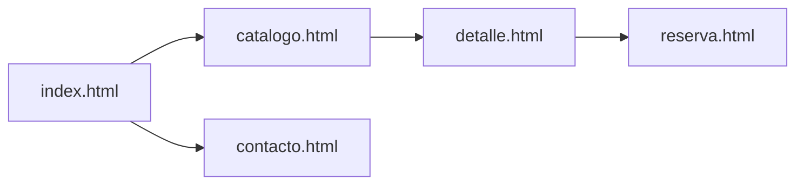

# Estructura de la web

<!-- LAB 04: sustituid lo que está entre < > y los ejemplos, y borrad estos comentarios. -->

## Guía rápida

- **Ver la web:** abrir `web/index.html` en el navegador, o usar la extensión Live Server de VS Code.
- **Cambiar colores y tipografía:** variables de `:root` en `<web/css/estilos.css>` (ver [estilos.md](estilos.md)).
- **Añadir una página:** <crearla a partir de ... y añadir su enlace al menú de todas las páginas>.

## Mapa de navegación

<!-- Lista anidada o diagrama Mermaid. Sustituid el ejemplo. -->

## Páginas

| Archivo | Finalidad | Se llega desde |
| --- | --- | --- |
| index.html | <Portada y acceso a las secciones> | <Todas (logo y menú)> |
| <contacto.html> | <Formulario de contacto> | <Menú principal> |

## Bloques comunes

- **Cabecera:** <logo + `nav.menu-principal`>
- **Pie:** <datos de contacto y enlaces legales>

## Componentes importantes por página

<Solo lo que necesita explicación: tablas dinámicas, galerías, formularios complejos…>

## Formularios

| Página | Campo | Tipo HTML | Dato del RETO (tabla.columna o clase) |
| --- | --- | --- | --- |
| <contacto.html> | <email> | <email, required> | <usuario.email> |

## Accesibilidad y validación

| Comprobación | Estado | Observaciones |
| --- | --- | --- |
| `lang` en `<html>` | <Sí / No> | |
| `alt` en todas las imágenes | <Sí / No> | |
| `<label>` en todos los campos | <Sí / No> | |
| Un solo `<h1>` por página | <Sí / No> | |
| Validador W3C sin errores | <Sí / No> | <Errores pendientes → pendientes.md> |
| Lighthouse, accesibilidad | <0-100> | <Página analizada> |
